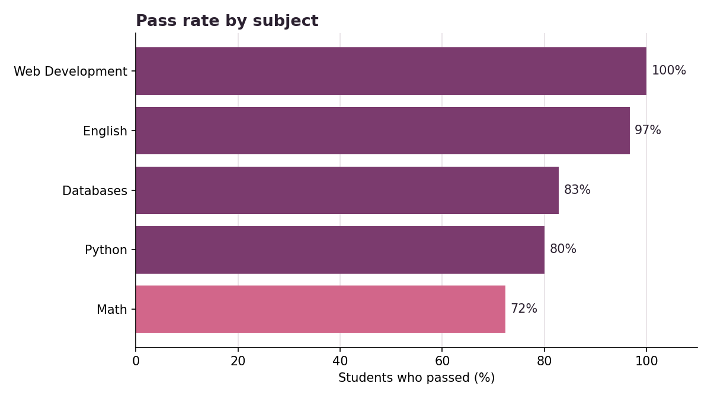
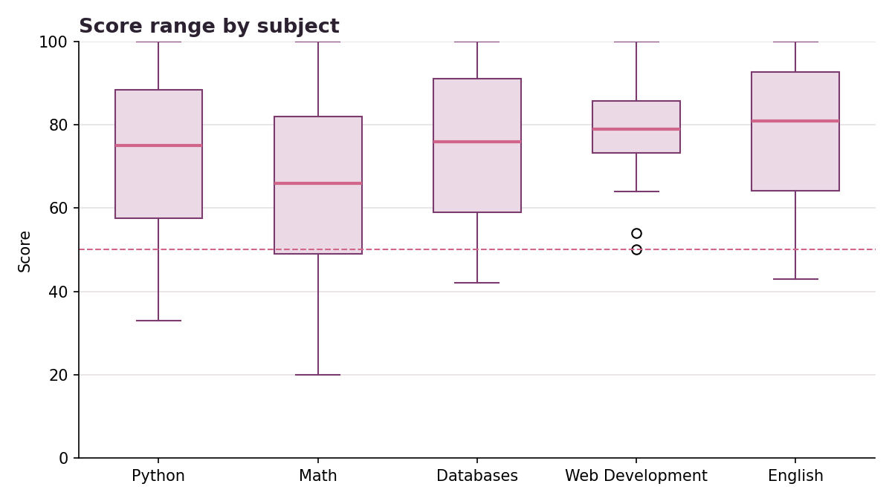
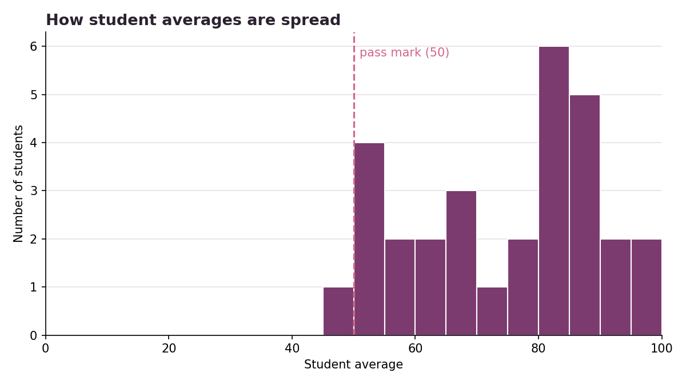

# Student Grades Analyzer

[](https://github.com/maysowais/student-grades-analyzer/actions/workflows/tests.yml)


A Python command-line tool for teachers and trainers. Give it a class gradebook (CSV or Excel) and it produces:

- an **Excel report** with student rankings, subject statistics and a highlighted follow-up list
- **charts** of how the class performed
- a **report card** for every student, comparing their scores with the class average
- a **follow-up list** of students who need attention, with the reason for each one

It is built around the questions a trainer asks after every course: who is struggling, which subject was hardest, and what should each student hear?

## Example

```text
$ python -m grades_analyzer sample_data/class_grades.csv

Gradebook: class_grades.csv  (30 students, 5 subjects)
  warning: 1 missing score(s) in 'Math'
  warning: 1 missing score(s) in 'Databases'

Class average:     74.4
Highest / lowest:  97.0 / 47.2
Passing students:  96.7%
Hardest subject:   Math (mean 65.2, pass rate 72.4%)

Top 3 students:
  1. Dana Nasser  97.0
  1. Leen Saleh  97.0
  3. Yara Khalil  92.6

Needs follow-up: 10 student(s)
  - Rawan Mansour (47.2): average 47.2 is below 60; failed 4 subjects (Python, Math, Databases, English)
  - Bilal Hamdan (52.2): average 52.2 is below 60; failed 2 subjects (Python, Math)
  ...

Saved: output/grades_report.xlsx
       3 charts in output/charts
       30 report cards in output/report_cards
```

| Pass rate by subject | Score range by subject |
|---|---|
|  |  |



Each student also gets a Markdown report card ([example](docs/sample_report_card.md)).

The sample data in `sample_data/` is fictional. It was generated with `scripts/make_sample_data.py`.

## Install

```bash
git clone https://github.com/maysowais/student-grades-analyzer.git
cd student-grades-analyzer
pip install -r requirements.txt
```

## Usage

```bash
python -m grades_analyzer path/to/grades.xlsx -o output
```

| Option | Default | Meaning |
|:--|:-:|:--|
| `-o, --output` | `output` | folder for the report, charts and report cards |
| `--pass-mark` | `50` | minimum score to pass a subject |
| `--risk-average` | `60` | flag students whose average is below this |
| `--max-failed` | `1` | flag students who fail more subjects than this |
| `--no-charts` | | skip the PNG charts |
| `--no-cards` | | skip the per-student report cards |

### Input format

One row per student. The first two columns are `student_id` and `name`. Header case and spaces do not matter, so `Student ID` works too. Every other column is a subject with scores from 0 to 100:

| student_id | name | Python | Math | Databases |
|---|---|---|---|---|
| S001 | Ahmad Haddad | 78 | 64 | 81 |
| S002 | Lina Khalil | 91 | | 88 |

Empty cells count as missing scores. The tool reports them and leaves them out of averages instead of counting them as zero. A file with text in a score column, a score outside 0–100, or a duplicated student ID is rejected with a clear error.

### How grades are calculated

- **Average:** mean of the scores the student has
- **Letter:** A ≥ 90, B ≥ 80, C ≥ 70, D ≥ pass mark, F below it
- **Rank:** by average; tied students share a rank
- **Needs follow-up:** average below `--risk-average`, more than `--max-failed` failed subjects, or any missing score

## Project structure

```text
grades_analyzer/
  loader.py     read and validate CSV/Excel gradebooks
  analysis.py   student and subject statistics, letter grades, follow-up rules
  charts.py     matplotlib charts
  report.py     Excel report (openpyxl formatting) and Markdown report cards
  cli.py        argparse command-line interface
tests/          pytest suite (loader, analysis and end-to-end CLI)
sample_data/    fictional 30-student gradebook (CSV and XLSX)
```

## Tests

```bash
python -m pytest
```

The tests also run on GitHub Actions for Python 3.10 and 3.12 on every push.

## Tech

Python · pandas · matplotlib · openpyxl · argparse · pytest · GitHub Actions

## License

MIT
